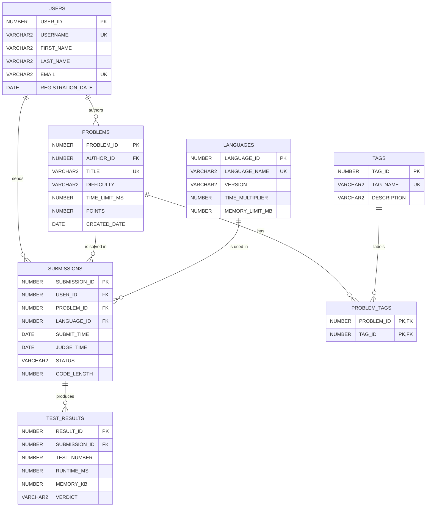

# Coding Judge Platform Database

An SQL assignment and its solution (Oracle SQL). Users solve programming problems on an online judge
like LeetCode. Each solution they send is a submission, and the judge stores the result of every test
it runs.

## ER diagram

To get a PNG for submission, paste `ER_DIAGRAM.dbml` into [dbdiagram.io](https://dbdiagram.io) and export it.

## Files

| File | What it is |
|---|---|
| `ASSIGNMENT.md` | The assignment: tables, relationships, constraints, sample data and required queries |
| `CODING_JUDGE_DATABASE.sql` | The solution: creates the tables with their constraints, inserts the sample data, runs 15 queries |
| `ER_DIAGRAM.dbml` | The ER diagram source for dbdiagram.io |

## Tables

| Table | Rows | Holds |
|---|---|---|
| `USERS` | 6 | People who solve and publish problems |
| `LANGUAGES` | 4 | Programming languages with their time multiplier and memory limit |
| `PROBLEMS` | 6 | Problems: author, difficulty, time limit, points |
| `TAGS` | 8 | Topics a problem can belong to |
| `PROBLEM_TAGS` | 12 | Which problem has which tag (many-to-many) |
| `SUBMISSIONS` | 13 | Each solution sent by a user, with its status |
| `TEST_RESULTS` | 31 | The result of each test the judge ran on a submission |

## How to run

Run `CODING_JUDGE_DATABASE.sql` from top to bottom in Oracle (SQL Developer, Oracle Live SQL or
SQL\*Plus). Invalid rows are rejected by the constraints, for example a duplicate email, difficulty
`'EXTREME'`, a judge time before the submit time, an accepted submission with no judge time, or two
results for the same test of one submission.
